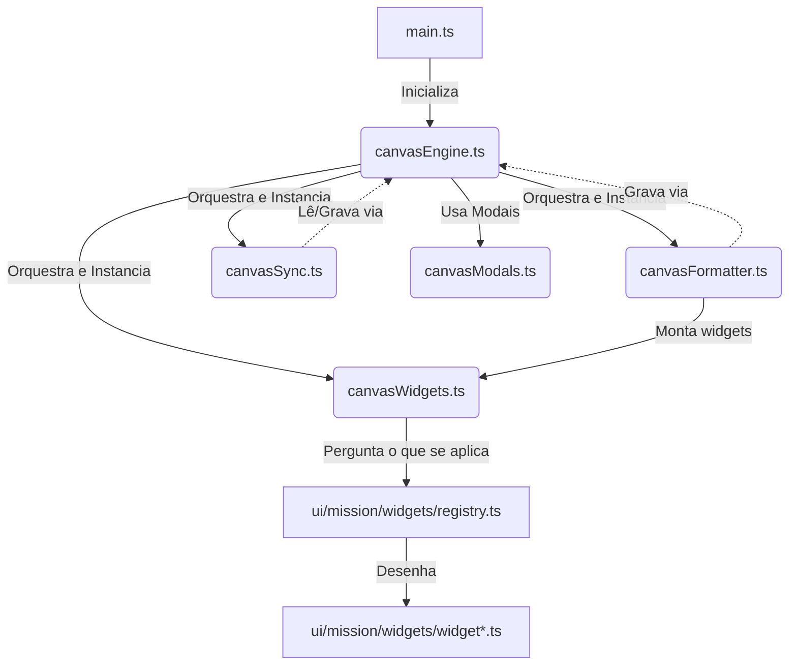

# Motor de Canvas Modular (CanvasEngine)

> [!WARNING] Estado em 2026-09-25
> A camada nova de canvas **não mora aqui**: widgets ```` ```dfm-widget ````, consultas,
> canvas geridos, cartão de tarefa e barras DFM estão em `src/board/`, `src/canvas/`,
> `src/project/` e `src/temporal/` (mapa em
> `200 - FUNCTIONS/Skills/System/dfm-canvas-dev/references/arquitetura.md`).
> Aqui continuam valendo: formatador (monta o cartão de tarefa), sincronização de
> `relacoes`/dependências, geradores de canvas estratégico e do esqueleto trimestral,
> e o contexto fractal.
> **Removido em 02/11/2026** (aposentadoria, fase 1, inventário 5.1): a camada morta dos
> widgets por marcador — `canvasWidgets.ts` (`CanvasWidgetHost`, criado e nunca chamado),
> `src/ui/mission/widgets/`, os gestos e a paleta (`widgetDrag*`, `widgetNode*`,
> `widgetPalette*`, `canvasMarker*`, `canvasWidgetPaletteModel.ts`), o catálogo lateral
> (`canvasRail*`, menos `canvasRailPlan.ts`, que o fractal usa) e o item de menu como widget
> (`canvasMenuRuntime.ts`). Os importadores foram traçados a partir de `main.ts`: o fractal só
> lia `planCanvasFileNodeInsertion` por uma reexportação do `canvasRail.ts`, e agora o lê do
> `canvasRailPlan.ts`. Ficam sem leitor, para a próxima passada: a família do menu do canvas
> (`canvasMenu.ts`, `canvasMenuModel.ts`, `canvasMenuPlan.ts`, `canvasMenuWriter.ts`,
> `canvasMenuApply.ts`; o `canvasMenuCanvas.ts` fica, o fractal o usa).
> O diagrama e as seções 4 e 5 abaixo são históricos.

Este diretório contém o motor modularizado de Canvas do plugin DFM System, orquestrando eventos do Obsidian e sincronizando metadados YAML das notas com conexões visuais.

## Arquitetura do Componente

A arquitetura é dividida em cinco componentes específicos sob o padrão de delegação e injeção de dependências:



### 1. Orquestrador (`canvasEngine.ts`)
- **Papel:** É o ponto de entrada principal (`CanvasEngine`). Ele coordena e centraliza o estado do sistema (como travas de concorrência, estados de inserção pendente de tarefas e modais ativos).
- **Responsabilidades:**
  - Registrar eventos do ciclo de vida do Obsidian (`vault.on('modify')`, `workspace.on('file-open')`, etc.).
  - **Edição por Duplo Clique:** Intercepta o clique duplo em nós do tipo `tasknote` no Canvas para abrir diretamente o modal de edição do plugin TaskNotes via API.
  - **Criação Zoom-Aware:** Insere novos cards de tarefas criados a partir do Canvas exatamente no centro visível do viewport (utilizando `canvas.getViewportBBox()` para calcular o offset com base no zoom e pan atuais).
  - Delegar a formatação visual dos nós ao `CanvasFormatter`.
  - Delegar a sincronização física e lógica das setas/dependências ao `CanvasSyncManager`.
  - Delegar a montagem dos widgets de missão ao `CanvasWidgetHost`.
  - Gerenciar o debounce físico de gravações para evitar loops infinitos de salvamento.

### 2. Sincronizador (`canvasSync.ts`)
- **Papel:** Lida com toda a lógica de leitura, escrita e modificação de arestas (edges), nós (nodes) e atualização dos metadados frontmatter (YAML) das notas Markdown comuns e SMART.
- **Responsabilidades:**
  - Sincronização bidirecional/reversa (`checkAndPromptReverseSync`): detecta se há conexões YAML ausentes no Canvas e solicita importação visual.
  - Gravar arestas removidas do Canvas nos metadados YAML das notas correspondentes.
  - Adicionar a referência do Canvas ao campo de **relações** da nota ou da tarefa (`addCanvasToProject` para nó de tarefa, `addCanvasToRelations` para nota comum). As duas rotas gravam o mesmo dado no mesmo campo (`relacoes`/`relations`) — a de tarefa deixou de escrever em `projects`, porque o canvas do projeto tem o mesmo nome do projeto e aquilo criava vínculo de projeto falso. Desde o Passo 0 da Missão (0d, 27/10/2026), a de tarefa também não grava nada quando o canvas tem o nome de um projeto ou de um departamento: o `relacoes` repetiria o `projects` (`managedIds.canvasNameIsProject`).
  - Geração automatizada de mapas mentais gerais (`generateDFMTreeCanvas`) e Canvas Estratégicos (`generateStrategicCanvas`). O canvas do trimestre era do `temporal/quarterCanvasManager.ts`, aposentado em 02/11/2026 (o gerador antigo, que lia o `quarter` do projeto, saiu no Passo 0 da Missão, 0c).

### 3. Formatador (`canvasFormatter.ts`)
- **Papel:** Cuida exclusivamente da identidade visual e do enriquecimento da interface visual (HUD) dos nós do Canvas.
- **Responsabilidades:**
  - Formatar o tamanho padrão dos cards de tarefas SMART (400x150).
  - Aplicar coloração baseada em status e prioridade.
  - Injetar no DOM dos elementos do Canvas o HUD de telemetria (`renderTaskHUD`) contendo badges de prioridade, data de vencimento/atraso e tempo trabalhado.
  - Suportar Drag & Drop de notas ou wikilinks comuns convertendo-os automaticamente em File Nodes estruturados.
  - Chamar o host de widgets no fim de `formatNode`. **O retorno da montagem não entra em `modified`**: widget vive no DOM, e marcar o nó como modificado faria o motor salvar o `.canvas` só para desenhar — e como salvar recria o DOM dos nós, isso viraria laço de salvar/remontar.

### 4. Host de Widgets (`canvasWidgets.ts`)
- **Papel:** É a ponte entre o motor e o **registro de widgets** que vive em `src/ui/mission/widgets/`. Generaliza o que o HUD fazia de forma pontual: em vez de um enriquecimento escrito à mão, um registro em que cada widget se declara.
- **Responsabilidades:**
  - Resolver o quadro da missão pelo **coletor compartilhado** (`plugin.getMissionControl()`, cache de 15 s) — o mesmo que o console usa. Abrir o console não faz o canvas reler o vault, e vice-versa.
  - Montar os widgets aplicáveis a cada nó via `mountCanvasWidgets`, e **remover** os que deixaram de se aplicar.
  - Aquecer o quadro uma vez por ciclo e repintar os canvas abertos **em silêncio** (`repaintWidgets`), sem `Notice` e sem salvar arquivo.
  - Acessar o coletor com guarda (`getMissionControl?.()`): esta função roda no caminho de formatação de **todo** nó, e um widget que não pode ser montado deve custar o widget, nunca a formatação.

### 5. Modais de Diálogo (`canvasModals.ts`)
- **Papel:** Modais nativos do Obsidian reutilizáveis pelo sincronizador para interação com o operador.
- **Componentes:**
  - `ConfirmModal`: Confirmações simples (Sim/Não).
  - `CanvasDependencyModal`: Caixa de diálogo com múltiplas escolhas para resolver divergências de sincronização de dependências.

---

## Widgets dentro do nó

Os widgets não moram neste diretório: eles são `src/ui/mission/widgets/*`, e este motor **não conhece widget nenhum** — ele pergunta ao registro quais se aplicam. Acrescentar um widget é acrescentar um arquivo lá e uma linha em `registry.ts`.

Duas famílias convivem, e a diferença é o que as dispara:

- **por arquivo** — o widget se aplica ao tipo do nó (`type: iniciativa` → projeto; `tasknote` com dependência declarada → tarefa);
- **por marcador** — o widget se aplica porque o operador **escreveu** um marcador no texto do nó (`dfm-missao`, `dfm-habitos`, ` ```dfm `). É o contrato de autoria: dá para colocar um painel vivo num canvas sem tocar em código.

O runtime (`src/ui/mission/widgets/runtime.ts`) garante três invariantes, e as três existem por causa de defeitos reais:

1. **Idempotência** — montar duas vezes não duplica (o Obsidian redesenha nós o tempo todo; dois HUDs no mesmo nó foi bug real deste plugin).
2. **Limpeza** — widget que deixou de se aplicar é removido: selo que sobrevive ao dado que o justificava vira mentira na tela.
3. **Silêncio** — nó sem widget aplicável não ganha casca vazia.

O estilo vive na seção `── Widgets de canvas` de `styles.css`, e o contrato de classes é verificado por `tests/ui/widgetStyles.test.ts`.

---

*DFM Modular System Architecture*
